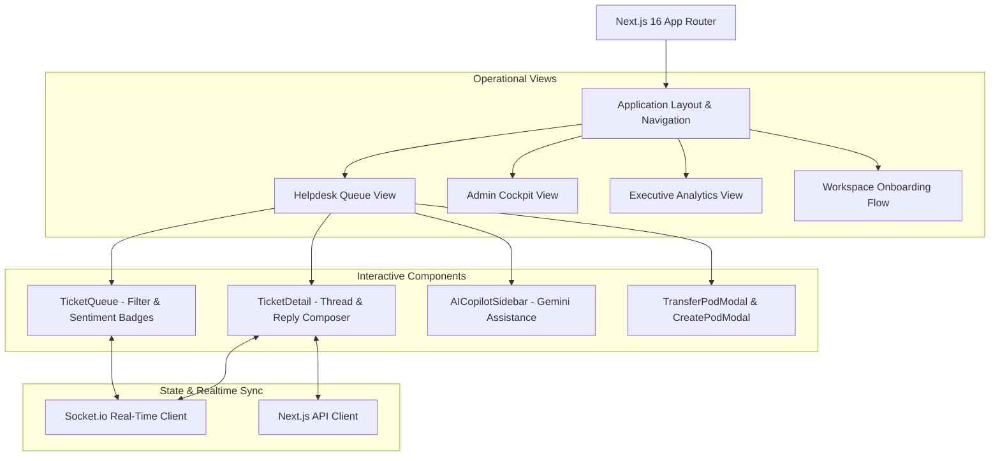

<div align="center">
  <br />
  <h1>✨ Sentirix Web Dashboard</h1>
  <p><strong>The Modern, Real-Time Next.js 16 Interface for AI-Native Customer Support</strong></p>
  <p><em>Equipped with instant sentiment badges, Google Gemini Copilot sidebar, live agent collision avoidance, and executive analytics.</em></p>

  <p>
    <a href="https://github.com/sentirix-ai/sentirix-web/actions"></a>
    <a href="https://nextjs.org"></a>
    <a href="https://react.dev"></a>
    <a href="https://tailwindcss.com"></a>
    <a href="https://www.typescriptlang.org"></a>
    <a href="https://socket.io"></a>
    <a href="LICENSE"></a>
  </p>
  <br />
</div>

---

## ⚡ What is Sentirix Web?

**Sentirix Web** is the frontend client for the Sentirix AI customer support platform. Engineered using **Next.js 16 (App Router)** and **React 19**, it delivers a sub-millisecond, real-time operating experience for support engineers, team leads, and workspace administrators.

---

## 🚀 Key User Experiences

### 1. 🎯 Real-Time Sentiment Triage Queue
Incoming tickets are dynamically prioritized and tagged with sentiment badges before an agent opens them:
* 🔴 **Frustrated**: High urgency customer dissatisfaction alert.
* 🟡 **Urgent**: Critical time-sensitive issue or SLA breach risk.
* 🟢 **Positive**: Favorable resolution or commendation.
* ⚪ **Neutral**: General inquiry or status request.

### 2. 🤖 Gemini AI Copilot Sidebar
* **1-Click Smart Replies**: Generates contextually accurate reply drafts tailored to customer tone.
* **Thread Summarization**: Condenses multi-turn conversations into concise bullet points for quick handoffs.

### 3. 🛡️ Live Agent Collision Detection
Prevents double-replies with real-time WebSocket presence:
* Visual indicator showing which agent is currently reading a ticket.
* Live `typing...` state indicator across all active agent sessions.

### 4. 🏢 Multi-Pod Management & Transfers
* Dedicated department pods (e.g., Billing, Tier 2 Engineering, Enterprise Success).
* 1-click ticket transfer between pods with internal handover notes.

### 5. 📊 Executive Analytics & Admin Cockpit
* Monitor SLA resolution velocities, volume spikes, and pod performance metrics.
* Role-Based Access Control (`ADMIN`, `AGENT`, `CUSTOMER`) with instant invite links.

---

## 🧩 UI Architecture & Modules



---

## 🛠️ Tech Stack

* **Framework**: [Next.js 16](https://nextjs.org) (App Router, Turbopack)
* **Core Library**: [React 19](https://react.dev)
* **Styling**: [Tailwind CSS 4](https://tailwindcss.com) with `@tailwindcss/turbopack`
* **Realtime**: [socket.io-client](https://socket.io) (WebSocket transport)
* **Icons**: [Lucide React](https://lucide.dev)
* **Utilities**: `clsx`, `tailwind-merge`

---

## 🚀 Getting Started (Local Setup)

### Prerequisites
* [Node.js](https://nodejs.org) (v18.0 or newer)
* [Sentirix Core API](https://github.com/sentirix-ai/sentirix-core) running on `http://localhost:4000`

### 1. Configure Environment Variables
Copy `.env.example` to create your local environment file:
```bash
cp .env.example .env.local
```
Ensure the API endpoints point to your running backend:
```env
NEXT_PUBLIC_API_URL="http://localhost:4000/api/v1"
NEXT_PUBLIC_SOCKET_URL="http://localhost:4000"
```

### 2. Install Dependencies
```bash
npm install
```

### 3. Run Development Server
```bash
npm run dev
```
Open [http://localhost:3000](http://localhost:3000) in your browser to access the Sentirix dashboard.

---

## 📦 Production Build

```bash
# Compile and optimize for production
npm run build

# Start production server
npm run start
```

---

## 📄 License

This project is licensed under the [MIT License](LICENSE).
